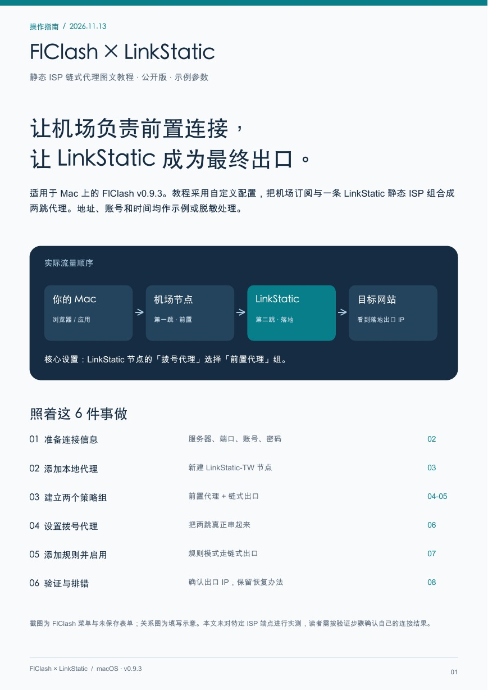
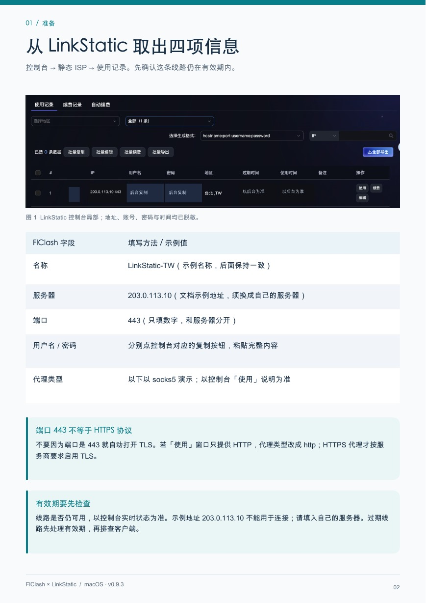
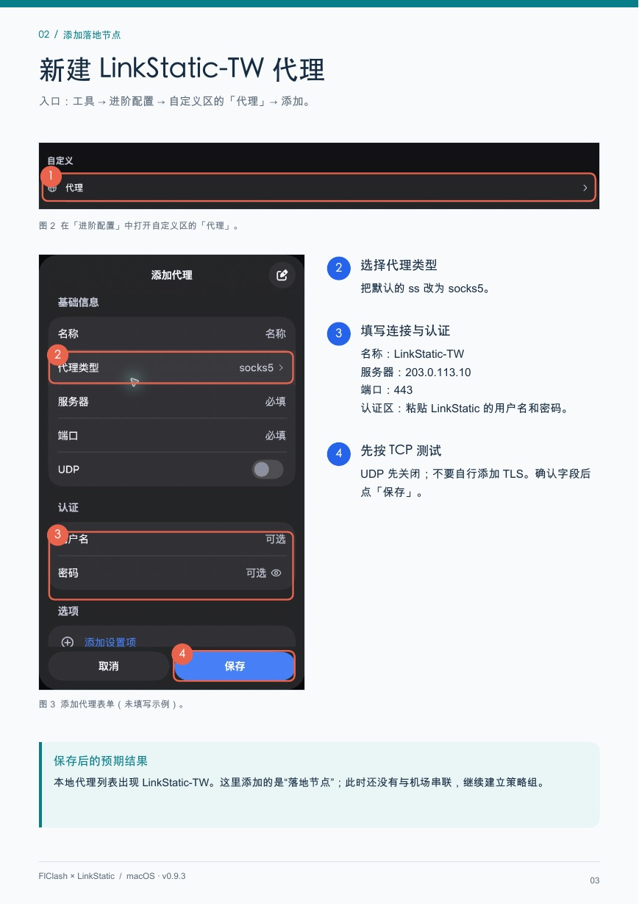
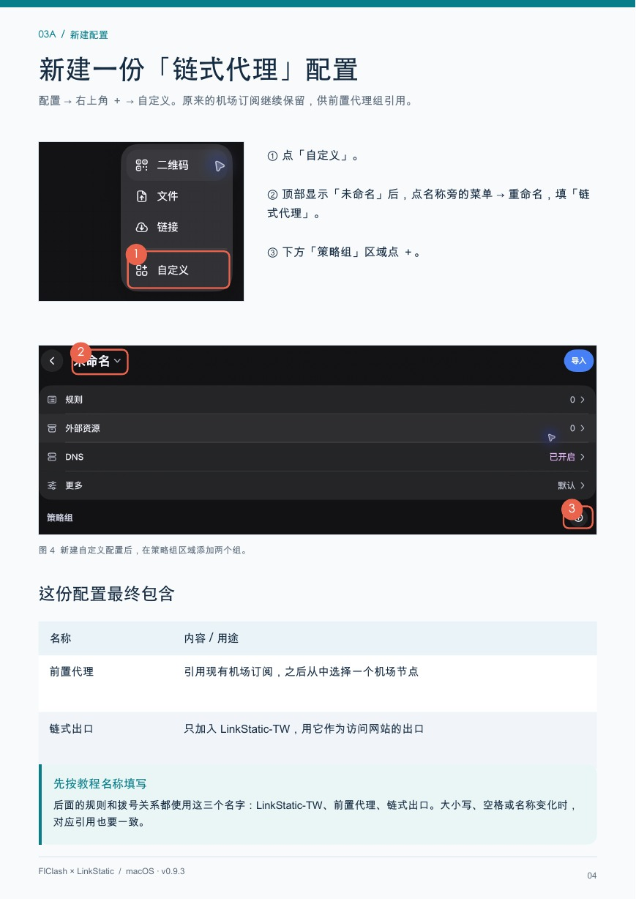
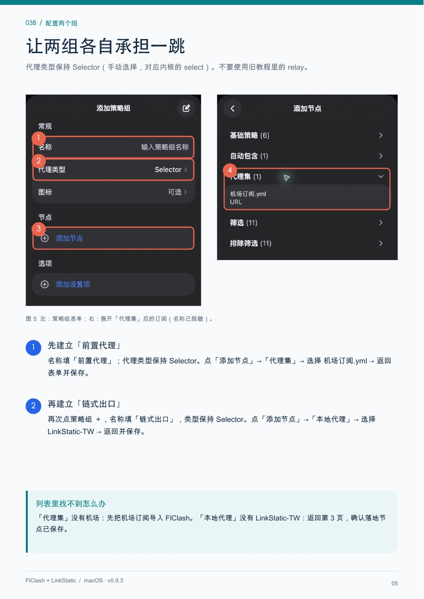
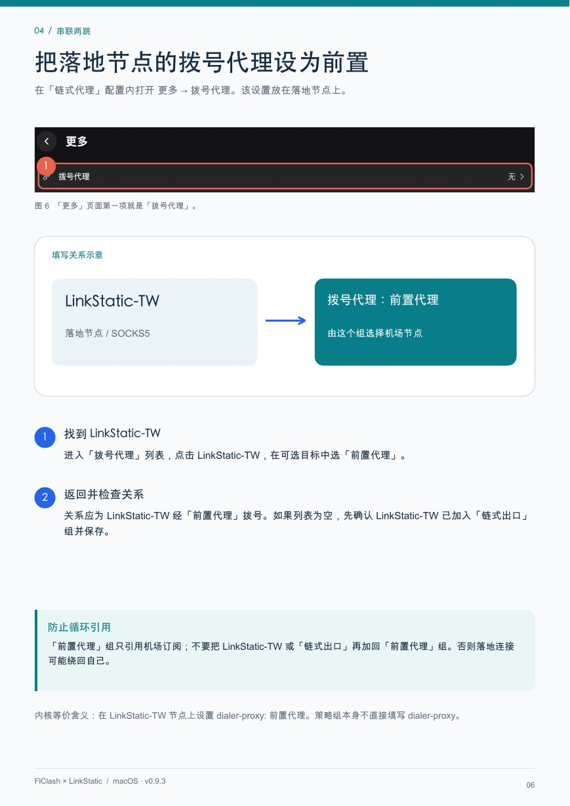
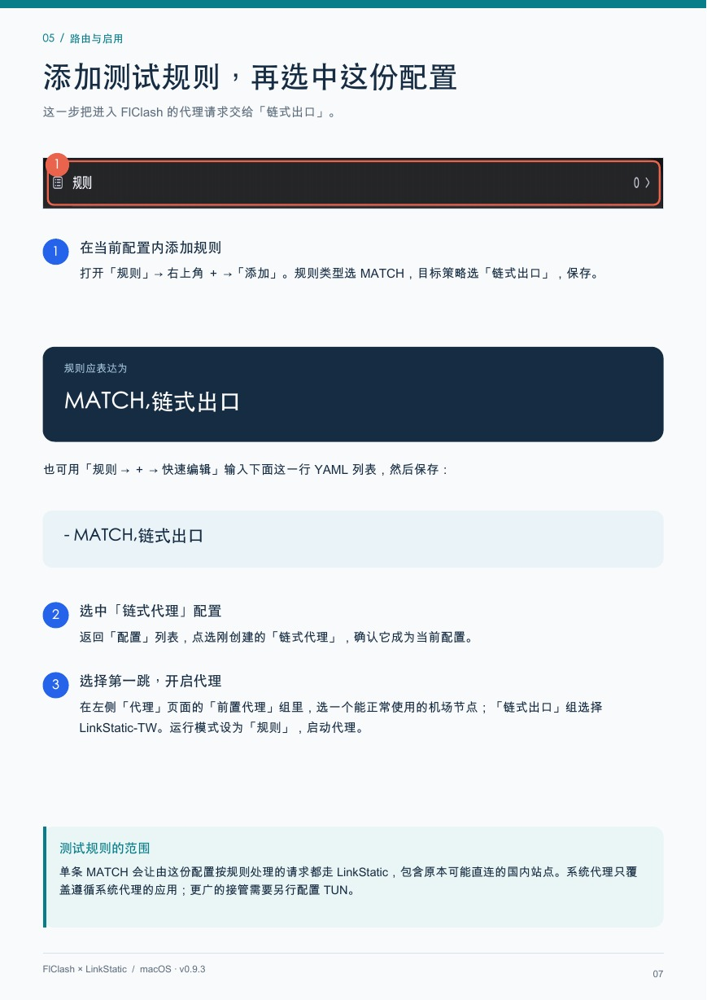
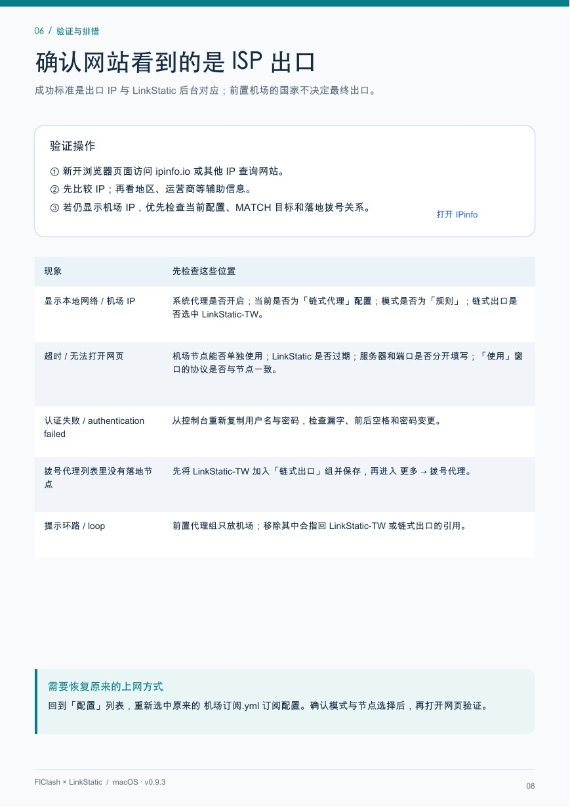
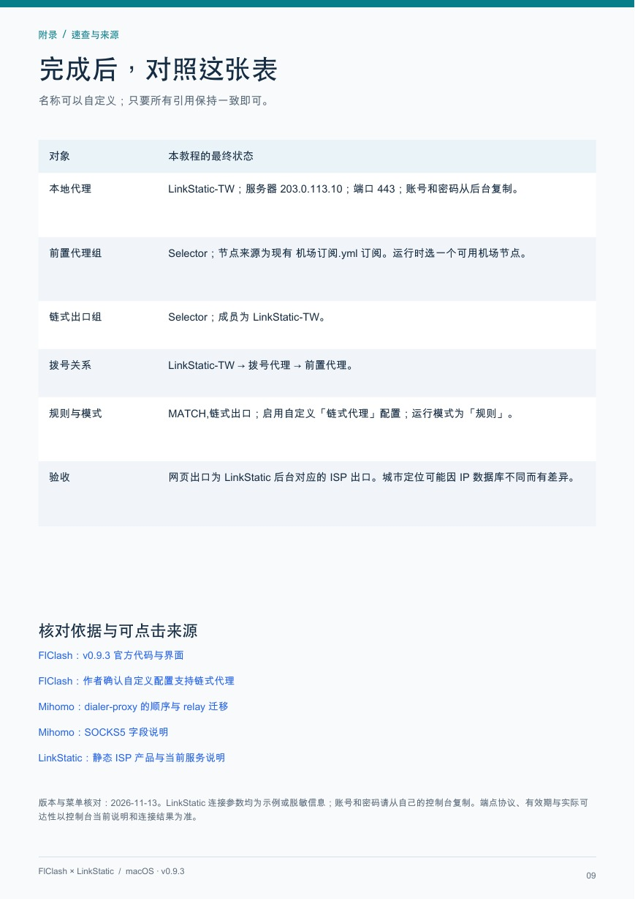

# FlClash × LinkStatic 静态 ISP 链式代理教程

适用于 **macOS / FlClash v0.9.3** 的中文图文教程。通过「自定义配置」将现有机场订阅与 LinkStatic 静态 ISP 组成两跳代理，包含菜单截图、参数对照、拨号关系、出口验证及常见问题。

**[阅读 / 下载 9 页 PDF](docs/flclash-linkstatic-guide.pdf)** · **[文件校验值](docs/SHA256SUMS)**

```text
你的 Mac → 机场节点（前置）→ LinkStatic 静态 ISP（落地）→ 目标网站
```

关键设置：**给 `LinkStatic-TW` 节点设置「拨号代理 = 前置代理」**，再让规则指向「链式出口」。

> 本仓库为公开版。`203.0.113.10` 是文档示例地址，无法用于连接；请换成自己的服务器。账号、密码、有效期与个人订阅名称已脱敏。协议、有效期与实际可达性以服务商当前控制台说明和自己的测试结果为准。

## 操作顺序

1. 在 LinkStatic 控制台取得服务器、端口、用户名和密码，并确认线路有效。
2. FlClash「工具 → 进阶配置 → 自定义 → 代理」添加 `LinkStatic-TW`。本教程按 `socks5` 演示；不要仅凭端口 `443` 就启用 TLS。
3. 「配置 → ＋ → 自定义」新建「链式代理」，创建两个 `Selector` 策略组：「前置代理」引用机场订阅，「链式出口」加入 `LinkStatic-TW`。
4. 在该自定义配置内打开「更多 → 拨号代理」，将 `LinkStatic-TW` 的拨号代理设为「前置代理」。前置组不要引用落地节点或链式出口，以免形成循环。
5. 在该配置内添加 `MATCH,链式出口` 规则；选中「链式代理」配置，使用「规则」模式，从前置组选择一个可用机场节点，并开启代理。
6. 新开 IP 查询页面，确认出口对应自己的 LinkStatic ISP 线路。

单条 `MATCH` 会让由该配置按规则处理的请求都走落地代理。系统代理覆盖遵循系统代理设置的应用；更广的流量接管需另行配置 TUN。本文未对任何读者的 ISP 端点进行实测。

## 在线图文阅读

### 1. 流程总览



### 2. 从 LinkStatic 取得连接信息



### 3. 添加 SOCKS5 落地节点



### 4. 新建自定义配置



### 5. 建立前置代理与链式出口组



### 6. 设置拨号代理



### 7. 添加规则并启用



### 8. 验证出口与故障排查



### 9. 完成状态速查与来源



## 版本与来源

- 菜单与文档核对日期：**2026-11-13**。
- [FlClash v0.9.3 官方仓库](https://github.com/chen08209/FlClash/tree/v0.9.3)
- [FlClash：自定义配置及链式代理说明](https://github.com/chen08209/FlClash/issues/2365)
- [Mihomo：dialer-proxy 与 relay 迁移](https://wiki.metacubex.one/config/proxies/dialer-proxy/)
- [Mihomo：SOCKS5 配置字段](https://wiki.metacubex.one/config/proxies/socks/)
- [LinkStatic 静态 ISP 产品说明](https://linkstatic.com/product/isp-proxy/)

截图与界面名称属于对应产品。本教程为独立使用说明。
